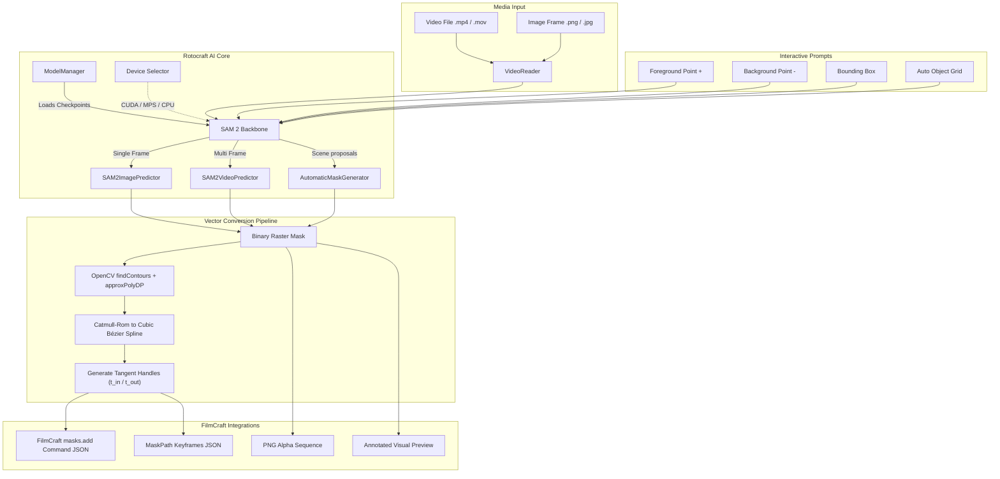

# Rotocraft: AI-Powered Automatic Rotoscoping for FilmCraft

[](LICENSE-MIT)
[](https://www.python.org/downloads/)
[](https://github.com/facebookresearch/segment-anything-2)
[]()

**Rotocraft** is a high-precision, automatic rotoscoping and object tracking engine built natively for the [FilmCraft](https://github.com/filmcraft/filmcraft) open-source video editor.

Powered by Meta's state-of-the-art **SAM 2 (Segment Anything Model 2)**, Rotocraft turns hours of painstaking manual keyframing into seconds of interactive AI segmentation. It operates **100% locally on your hardware** (NVIDIA CUDA, Apple Silicon MPS, or CPU), producing mathematically smoothed cubic Bézier paths that drop directly into FilmCraft's native mask engine.

---

## Quickstart (Simple 1-Click Launch)

No command line needed! Rotocraft includes an interactive visual studio:

- **Windows**: Double-click `start_rotocraft.bat` (or run `.\start_rotocraft.bat` from terminal)
- **macOS / Linux**: Run `./start_rotocraft.sh`
- **CLI**: `rotocraft app` or `rotocraft ui`

Your browser opens to **Rotocraft Studio** (`http://127.0.0.1:8765`):
1. **Open Media**: Drag & drop any video/image (or click **"⚡ Open Demo Shot"** to try immediately).
2. **Click on Object**:
   - **Left-Click**: Add green point (+) to keep the subject.
   - **Right-Click**: Add red point (-) to exclude background.
   - Live mask updates instantaneously!
3. **Auto-Rotoscope**: Click **"▶ Auto-Rotoscope Timeline"** to track across all frames.
4. **Send to FilmCraft**: Click **"⚡ Send Mask to FilmCraft"** to inject the Bézier mask directly onto your active clip!

---

## Table of Contents

- [Quickstart (Simple 1-Click Launch)](#quickstart-simple-1-click-launch)
- [Why Rotocraft?](#why-rotocraft)
- [Key Features](#key-features)
- [Architecture](#architecture)
- [Installation](#installation)
- [Interactive Web Studio](#interactive-web-studio)
- [Command Line Usage](#command-line-usage)
  - [1. Single-Frame Interactive Segmentation](#1-single-frame-interactive-segmentation)
  - [2. Multi-Frame Video Tracking](#2-multi-frame-video-tracking)
  - [3. Automatic Scene Discovery](#3-automatic-scene-discovery)
  - [4. Visual Mask Preview](#4-visual-mask-preview)
  - [5. Model Weight Management](#5-model-weight-management)
- [Python API](#python-api)
- [FilmCraft Integration](#filmcraft-integration)
  - [Bézier Path Geometry & Catmull-Rom Smoothing](#bézier-path-geometry--catmull-rom-smoothing)
  - [Engine Command Protocol (`masks.add`)](#engine-command-protocol-masksadd)
- [Supported SAM 2 Models](#supported-sam-2-models)
- [Testing](#testing)
- [License](#license)

---

## Why Rotocraft?

Traditional rotoscoping requires video editors and VFX artists to manually draw, adjust, and keyframe Bézier spline masks every few frames—costing hundreds of person-hours per sequence.

Rotocraft revolutionizes this workflow:
- **Instant Interactive Prompts**: Click one point or drag a bounding box around an actor, vehicle, or prop, and Rotocraft isolates the subject immediately.
- **Temporal Memory Propagation**: Tracks complex non-rigid motion, occlusions, and scale changes seamlessly forward and backward across entire shots.
- **Zero Cloud Latency & Total Privacy**: All neural network inference executes locally on your workstation. No subscription fees, telemetry, or remote frame uploads.
- **Native FilmCraft Compatibility**: Unlike generic rotoscoping scripts that output heavy raster video mattes, Rotocraft converts boundaries to lightweight, editable **Cubic Bézier vector paths** with incoming and outgoing tangent handles.

---

## Key Features

- **SAM 2 Neural Backbone**: Meta Hiera hierarchical vision transformer architecture (Tiny, Small, Base+, Large).
- **Hardware Auto-Detection**: Prioritizes `CUDA` (NVIDIA GPUs) > `MPS` (Apple Silicon M1/M2/M3/M4) > multi-threaded `CPU`.
- **Hybrid Export Pipelines**:
  - **Vector**: FilmCraft `MaskPath` JSON with editable Bézier vertices and Catmull-Rom tangent handles.
  - **Raster**: 8-bit / 16-bit PNG alpha sequences for matte compositing and VFX passes.
  - **Direct Command**: IPC/MCP JSON payload ready for FilmCraft's `masks.add` engine command.
- **ONNX Runtime Fallback**: Seamless fallback support when running in lightweight headless environments.
- **Interactive Multi-Prompting**: Combine positive points, negative exclusion points, and bounding boxes for pinpoint boundary refinement.

---

## Architecture



---

## Installation

### Prerequisites

- Python 3.10, 3.11, 3.12, or 3.13
- Recommended: NVIDIA GPU with CUDA 12.x or Apple Silicon Mac

### 1. Install Rotocraft

From the FilmCraft workspace root:

```bash
cd tools/rotocraft
pip install -e .
```

### 2. Install PyTorch with Hardware Acceleration

#### NVIDIA CUDA (Windows / Linux):
```bash
pip install torch torchvision --index-url https://download.pytorch.org/whl/cu124
```

#### Apple Silicon (macOS):
```bash
pip install torch torchvision
```

#### CPU Only:
```bash
pip install torch torchvision --index-url https://download.pytorch.org/whl/cpu
```

### 3. Install SAM 2

```bash
pip install git+https://github.com/facebookresearch/segment-anything-2.git
```

---

## Command Line Usage

Rotocraft provides the `rotocraft` CLI command:

### 1. Single-Frame Interactive Segmentation

Segment an actor using a foreground click point:

```bash
rotocraft segment -i frame.png -o output/ -p 480,360 -m small -f png
```

Refine with multiple foreground and background points:

```bash
rotocraft segment -i frame.png -o output/ \
  -p 480,360 -p 510,420 \
  --bg-point 200,100 \
  -b 350,200,650,800 \
  -f filmcraft --clip-id clip-01
```

### 2. Multi-Frame Video Tracking

Track a subject across a video shot from frame 0 to frame 120:

```bash
rotocraft track -i clip.mp4 -o masks/ \
  -p 960,540 \
  -b 800,400,1120,800 \
  --start-frame 0 \
  --end-frame 120 \
  -m small \
  -f png
```

Export directly to FilmCraft engine JSON format:

```bash
rotocraft track -i clip.mp4 -o masks/ -p 960,540 -f filmcraft --clip-id clip-01
```

Generate a video preview overlay with green matte visualization:

```bash
rotocraft track -i clip.mp4 -o preview_out/ -p 960,540 -f video
```

### 3. Automatic Scene Discovery

Automatically identify and isolate all subjects in an image:

```bash
rotocraft auto -i wide_shot.jpg -o auto_masks/ --min-area 0.002 -m small -f png
```

### 4. Visual Mask Preview

Inspect a generated mask overlaid on the original image:

```bash
rotocraft preview -i footage.png -k masks/mask_000000.png -o preview.png
```

### 5. Model Weight Management

View available models and download status:

```bash
rotocraft models --list
```

Pre-download model weights to the local cache:

```bash
rotocraft models --download sam2_hiera_small
```

---

## Python API

Rotocraft exposes a clean, typed Python API:

```python
from rotocraft import RotocraftSegmenter, MaskExporter, VideoReader, save_preview
import cv2

# 1. Initialize segmenter (auto-detects CUDA / MPS / CPU)
segmenter = RotocraftSegmenter(model_name="small")

# 2. Segment a single frame with point prompt
result = segmenter.segment_frame(
    image="actor.png",
    points=[[640, 480]],      # [x, y] coordinates
    labels=[1],               # 1: foreground, 0: background
)
mask = result.primary_mask    # 2D boolean numpy array (H, W)

# 3. Export to FilmCraft Bézier vector format
filmcraft_mask = MaskExporter.to_filmcraft_path(mask, simplify_epsilon=1.5)
print(filmcraft_mask)
# {
#   "closed": True,
#   "vertices": [
#     {"p": [640.0, 320.0], "in": [-12.4, 0.0], "out": [12.4, 0.0]},
#     ...
#   ]
# }

# 4. Generate FilmCraft engine command
command = MaskExporter.to_filmcraft_command(
    mask=mask,
    clip_id="clip-v1",
    effect_index="opacity"
)

# 5. Save annotated preview image
save_preview(
    image=cv2.imread("actor.png"),
    mask=mask,
    points=[[640, 480]],
    output_path="preview.png"
)
```

### Video Tracking API

```python
from rotocraft import RotocraftSegmenter

segmenter = RotocraftSegmenter(model_name="small")

# Track object 1 starting at frame 0
prompts = {
    0: [{"obj_id": 1, "points": [[960, 540]], "labels": [1]}]
}

tracked_frames = segmenter.segment_video(
    video_path="input_scene.mp4",
    prompts=prompts,
    output_dir="output_masks/",
    start_frame=0,
    end_frame=60,
    output_format="png"
)

for frame_idx, objects in tracked_frames.items():
    obj_mask = objects[1] # 2D numpy mask for object 1
```

---

## FilmCraft Integration

### Bézier Path Geometry & Catmull-Rom Smoothing

FilmCraft defines masks in clip pixel space using closed cubic Bézier curves:

```rust
pub struct MaskVertex {
    pub p: Vec2,      // Anchor position [x, y]
    pub t_in: Vec2,   // Tangent vector approaching p (relative)
    pub t_out: Vec2,  // Tangent vector departing p (relative)
}
```

Rotocraft converts raw polygon contours into smooth curves using Catmull-Rom splines converted to cubic Bézier form:
- For vertex $P_i$, the outgoing tangent is $t_{out} = \frac{P_{i+1} - P_{i-1}}{6}$.
- The incoming tangent is $t_{in} = -\frac{P_{i+1} - P_{i-1}}{6} = -t_{out}$.
- Turns sharper than $145^\circ$ are preserved as corner vertices with zero tangents ($t_{in} = [0,0], t_{out} = [0,0]$).

### Engine Command Protocol (`masks.add`)

The generated JSON directly satisfies FilmCraft's `masks.add` engine specification:

```json
{
  "clip": "c6218d6f-784f-40e9-9134-2e90f227b2c0",
  "effect": "opacity",
  "shape": "bezier",
  "path": {
    "closed": true,
    "vertices": [
      {
        "p": [960.0, 540.0],
        "in": [-32.5, -4.2],
        "out": [32.5, 4.2]
      },
      {
        "p": [1050.0, 680.0],
        "in": [-18.1, -22.4],
        "out": [18.1, 22.4]
      },
      {
        "p": [870.0, 680.0],
        "in": [20.0, -15.0],
        "out": [-20.0, 15.0]
      }
    ]
  }
}
```

---

## Supported SAM 2 Models

| Model | Checkpoint File | VRAM Req. | Speed | Ideal Use Case |
|---|---|---|---|---|
| **`sam2_hiera_tiny`** | `sam2_hiera_tiny.pt` (~156 MB) | 2–4 GB | Real-time (>45 FPS) | Fast previews, laptops, CPU mode |
| **`sam2_hiera_small`** *(Default)* | `sam2_hiera_small.pt` (~185 MB) | 4–6 GB | Fast (~30 FPS) | Balanced speed & edge fidelity |
| **`sam2_hiera_base_plus`** | `sam2_hiera_base_plus.pt` (~323 MB) | 6–8 GB | High Quality (~20 FPS) | Fine edge hair/fur details |
| **`sam2_hiera_large`** | `sam2_hiera_large.pt` (~898 MB) | 10+ GB | Production (~12 FPS) | Final rotoscoping export, complex occlusions |

Weights are automatically downloaded and cached in:
`~/.cache/rotocraft/models/` (customizable via `ROTOCRAFT_CACHE_DIR`).

---

## Testing

Run the full pytest suite:

```bash
pytest tools/rotocraft/tests -v
```

The test suite covers:
- Polygon contour extraction and area filtering
- Catmull-Rom tangent computation and corner detection
- FilmCraft `MaskPath` schema compliance
- Bidirectional IoU reconstruction accuracy (> 92%)
- Engine command structure
- VideoReader & VideoWriter seek/frame accuracy
- Click CLI options, flags, and error handling

---

## License

Rotocraft is dual-licensed under:

- **MIT License** ([LICENSE-MIT](../../LICENSE-MIT))
- **Apache License, Version 2.0** ([LICENSE-APACHE](../../LICENSE-APACHE))

at your option, matching the FilmCraft video editor licensing.
